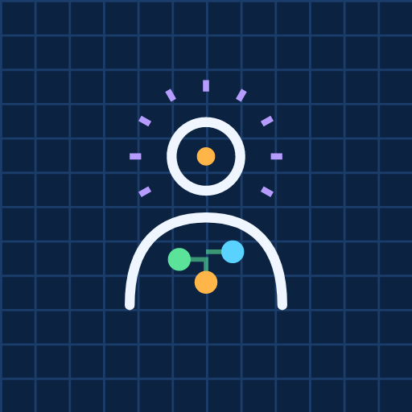
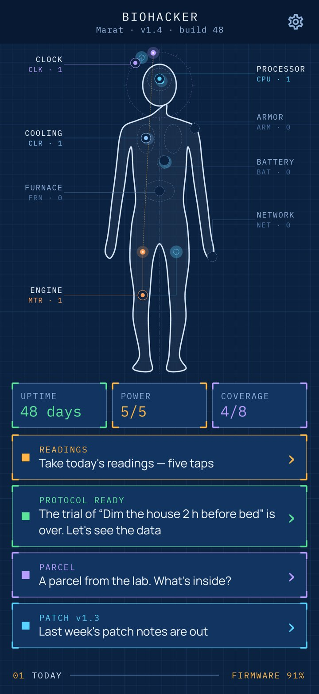
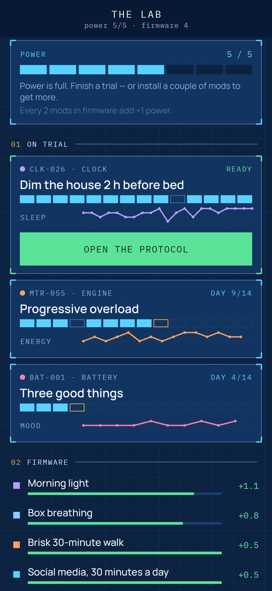
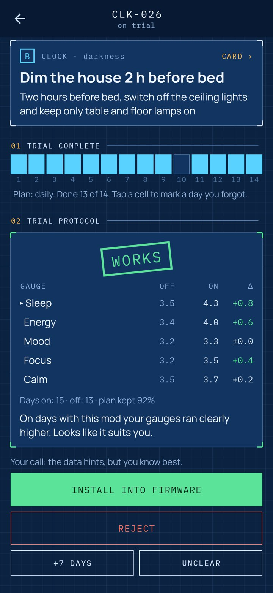
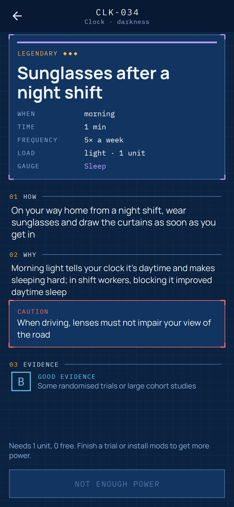
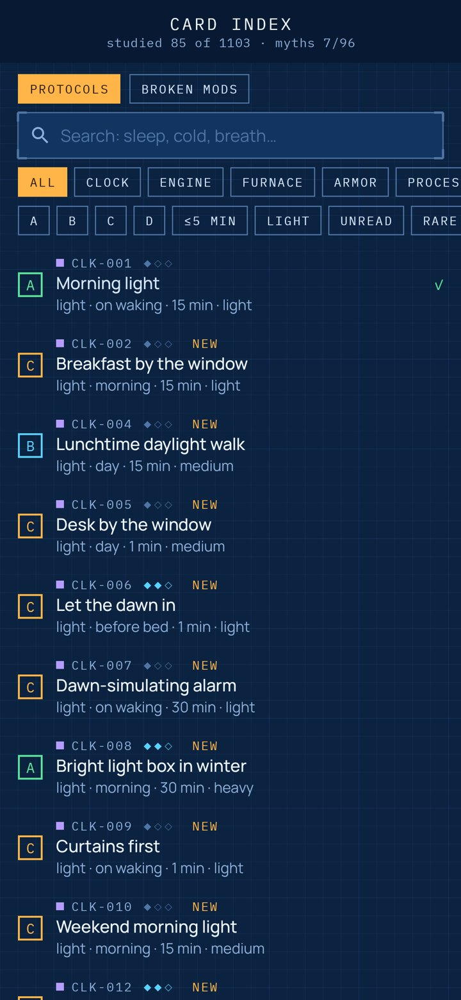
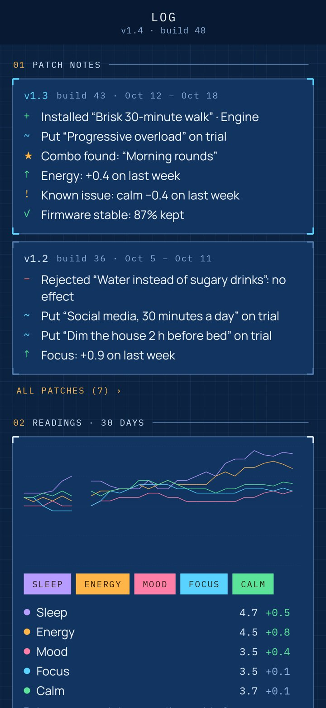

<div align="center">



# Biohacker

### Over a thousand protocols for a longer, calmer, happier life — each one tried on you for 14 days before it earns a place in your firmware.

*There are thousands of tips for sleep, fitness, food, stress and happiness, and only some of them will work for you. Biohacker draws your body as a blueprint with eight systems and turns every protocol into a mod. Put a mod on trial, take five quick readings a day, and after two weeks the lab shows whether it moved anything. You decide: install it, or reject it. Free, no ads, no account, no internet.*

[](https://github.com/bigdevwhale/biohacker/actions/workflows/android.yml)
[](https://github.com/bigdevwhale/biohacker/releases/latest)


[](LICENSE)

**English** · [Русский](README.ru.md) · [Changelog](CHANGELOG.md)

     

</div>

---

## How it works

1. **The blueprint.** Your body is a technical drawing with eight systems: Clock (sleep, light, rhythm), Engine (movement and strength), Furnace (food and water), Armor (hardening and prevention), Processor (focus and learning), Cooling (stress and breath), Battery (mood and meaning) and Network (people and nature). Every mod that works for you lights up as a node in its system.
2. **1103 protocols.** Each card says exactly what to do, why it works, when, for how long and how often, with cautions where they matter. Every card carries an honest evidence class: **A** strong, **B** good, **C** plausible, **D** weak but harmless. Search and filter by system, evidence, time and effort.
3. **Trials, n = 1.** Put a mod on trial for 14 days and tick it off on the days you do it. The lab compares your gauges on days with the mod (and the morning after) against days without it, including the two weeks before. Then it stamps the protocol: works, no effect, worse, or not enough data. Install it, reject it, extend it a week, or set it aside.
4. **Five readings a day.** Sleep, energy, mood, focus, calm — one tap each, about ten seconds.
5. **Power.** Trials running at once can't outweigh your power: light mods take one unit, heavy ones three. Every two installed mods add a unit. That's how habits stick: a few at a time.
6. **A parcel every day.** A sealed card arrives from the lab: common, rare or legendary, leaning towards the systems you care about. Sometimes it's a broken mod: one of 96 popular hacks that didn't hold up, with what the evidence actually says.
7. **Hidden combos.** Forty pairings of mods, like morning light with cold water, or a walk with a friend. They are found by installing both halves and drawn as gold links on the blueprint.
8. **Version and patch notes.** You start at v1.0, and every installed mod bumps the version. Each Monday brings patch notes: what was installed and rejected, which gauge went up, known issues.
9. **Glitches, not failures.** A day in the red brings an emergency patch: three short, well-backed mods for whatever sagged. Uptime counts your days of readings, and one missed day a week is bridged.
10. **Scheduled service.** Check-ups that catch faults early: blood pressure, dentist, blood tests, mole check, screenings, vaccines, eyes, first-aid kit.
11. **The head of the lab explains each screen** the first time it opens. You get one reminder a day, and only if today's readings aren't in.

Biohacker summarises research. It is not medical advice. If you have a condition, are pregnant or take medication, check with your doctor.

## Build

```
./gradlew testDebugUnitTest assembleDebug
./gradlew -Pdemo assembleDebug          # app.biohacker.demo with seven weeks of trials already run
./gradlew testDebugUnitTest -Prender --tests '*RenderArt*'   # screens to app/build/art, icon to docs/logo.png
python tools/check_content.py           # validates the catalogue in app/src/main/assets/content
```

The blueprint is drawn in code (`ui/art/Blueprint.kt`): a spline outline, organs in dashes, a clock dial round the head, hubs with leader lines, traces to every node. Sounds (relay click, stamp, tape tearing, install chime) are synthesised on first launch. The catalogue's rules are in [docs/CONTENT.md](docs/CONTENT.md).

Fonts: [IBM Plex Mono](https://github.com/IBM/plex) and [Manrope](https://github.com/sharanda/manrope), both under the SIL Open Font License.
