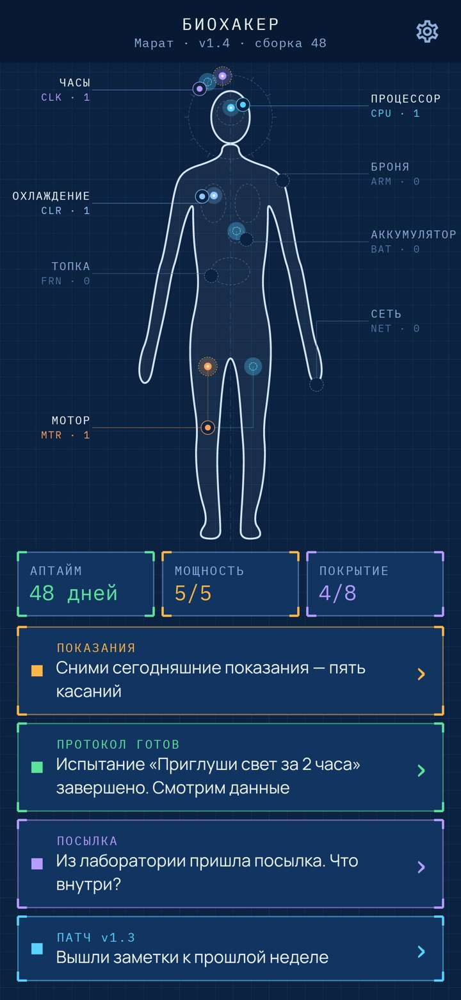
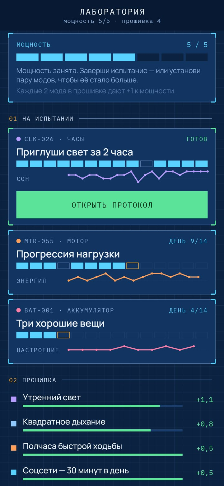
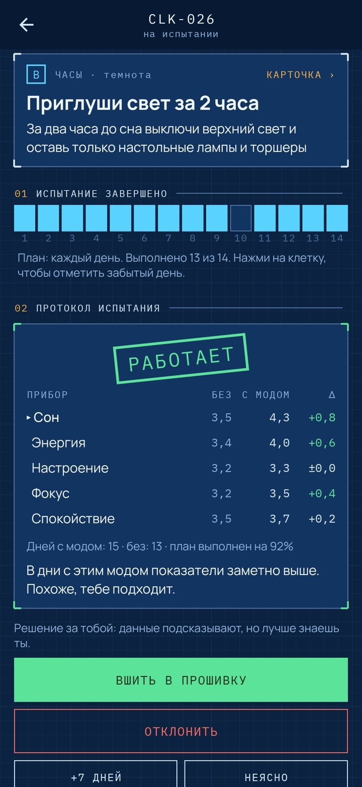
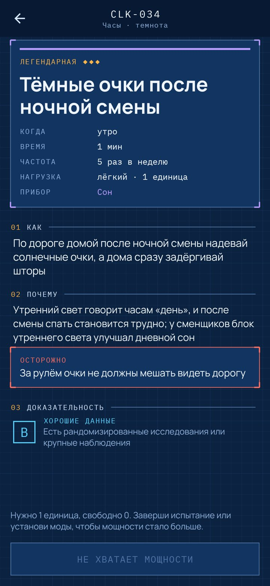
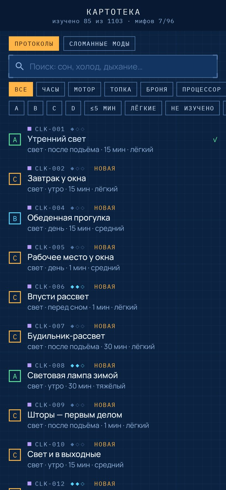
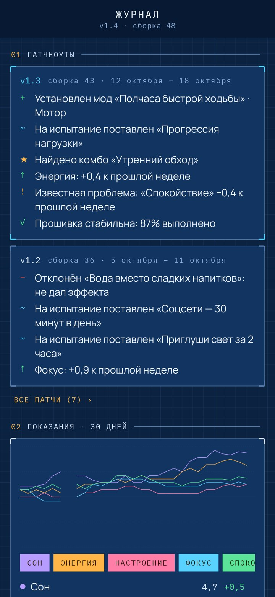

<div align="center">


# Биохакер

### Больше тысячи протоколов для долгой, спокойной и счастливой жизни — каждый 14 дней проверяется на тебе, прежде чем попасть в прошивку.

*Советов про сон, спорт, еду, стресс и счастье — тысячи, а работает для тебя лишь часть. «Биохакер» рисует тело чертежом из восьми систем и превращает каждый протокол в мод. Ставишь мод на испытание, раз в день снимаешь пять показаний — и через две недели лаборатория показывает, сдвинул ли он что-нибудь. Решаешь ты: вшить в прошивку или отклонить. Бесплатно, без рекламы, без аккаунта и без интернета.*

[](https://github.com/bigdevwhale/biohacker/releases/latest)

[English](README.md) · **Русский** · [Изменения](CHANGELOG.md)

     

</div>

---

## Как это устроено

1. **Чертёж.** Тело — технический чертёж из восьми систем: Часы (сон, свет, ритм), Мотор (движение и сила), Топка (еда и вода), Броня (закалка и профилактика), Процессор (фокус и обучение), Охлаждение (стресс и дыхание), Аккумулятор (настроение и смысл) и Сеть (люди и природа). Каждый мод, который тебе подошёл, загорается узлом в своей системе.
2. **1103 протокола.** На каждой карточке — что именно делать, почему это работает, когда, сколько времени и как часто, а где нужно — предупреждение. У каждой честный класс доказательности: **A** — сильные данные, **B** — хорошие, **C** — правдоподобно, **D** — слабые, но безвредно. Поиск и фильтры по системам, доказательности, времени и нагрузке.
3. **Испытания, n = 1.** Ставишь мод на испытание на 14 дней и отмечаешь дни, когда его выполнил. Лаборатория сравнивает показания в дни с модом (и следующее утро) с днями без него, включая две недели до старта. Итог — штамп на протоколе: «работает», «нет эффекта», «хуже» или «мало данных». Мод можно вшить в прошивку, отклонить, продлить на неделю или отложить.
4. **Пять показаний в день.** Сон, энергия, настроение, фокус, спокойствие — по одному касанию, секунд десять.
5. **Мощность.** Испытания, идущие одновременно, не могут весить больше мощности: лёгкий мод занимает 1 единицу, тяжёлый — 3. Каждые два установленных мода дают +1. Так привычки и приживаются — понемногу.
6. **Посылка каждый день.** Из лаборатории приходит запечатанная карточка — обычная, редкая или легендарная, чаще из тех систем, что тебе важны. Иногда внутри сломанный мод: один из 96 популярных хаков, которые не подтвердились, и что на самом деле говорят данные.
7. **Скрытые комбо.** Сорок сочетаний модов — например, утренний свет и холодная вода или прогулка с другом. Комбо находится, когда установлены обе половинки, и обводится на чертеже золотым кольцом.
8. **Версия и патчноуты.** Ты начинаешь с v1.0, и каждый установленный мод поднимает версию. По понедельникам выходят патчноуты: что установлено и отклонено, какой прибор вырос, известные проблемы.
9. **Глитчи, а не провалы.** День в красной зоне — это аварийный патч: три коротких мода с хорошими данными для того, что просело. Аптайм считает дни с показаниями, и один пропуск в неделю не обнуляет счёт.
10. **Плановое ТО.** Проверки, которые ловят поломки заранее: давление, стоматолог, анализ крови, осмотр родинок, скрининги, прививки, зрение, аптечка.
11. **Заведующий лабораторией объясняет каждый экран**, когда тот открывается впервые. Напоминание приходит одно в день, и только если показания ещё не сняты.

«Биохакер» обобщает исследования, но не заменяет врача. Если есть болезни, беременность или лекарства — посоветуйся с врачом.

## Сборка

```
./gradlew testDebugUnitTest assembleDebug
./gradlew -Pdemo assembleDebug          # app.biohacker.demo — семь недель испытаний уже прошли
./gradlew testDebugUnitTest -Prender --tests '*RenderArt*'   # экраны в app/build/art, иконка в docs/logo.png
python tools/check_content.py           # проверка каталога в app/src/main/assets/content
```

Чертёж рисуется кодом (`ui/art/Blueprint.kt`): контур сплайном, органы пунктиром, циферблат вокруг головы, хабы с выносками и дорожки к каждому узлу. Звуки (щелчок реле, штамп, треск скотча, сигнал установки) синтезируются при первом запуске. Правила каталога — в [docs/CONTENT.md](docs/CONTENT.md).

Шрифты: [IBM Plex Mono](https://github.com/IBM/plex) и [Manrope](https://github.com/sharanda/manrope), оба под SIL Open Font License.
